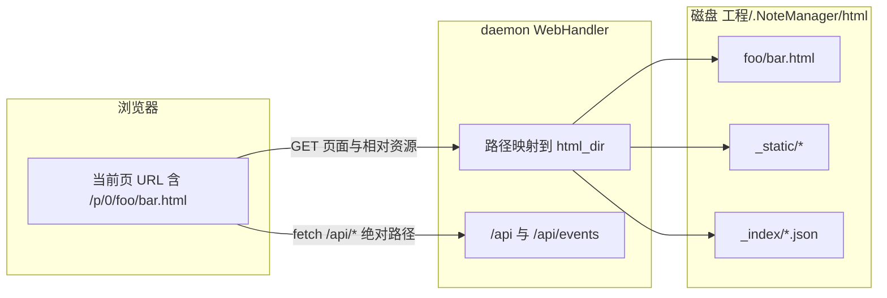

# html 网页结构

本章说明 **`工程/.NoteManager/html/` 下生成站点的设计原理**，以及它与 **`daemon` 内置 HTTP 服务**（`notemanager/web.py`）如何配合。构建由 `builder.py` 驱动，页面壳由 `renderer/template.py` 的 `wrap_html` 生成。

---

## 1. 设计目标

1. **磁盘上是自描述站点**：`html/` 内包含页面、共享静态资源、搜索索引 JSON，目录结构与源码树一致（`foo/bar.rst` → `html/foo/bar.html`）。拷贝整个 `html/` 到别处，用静态服务器打开仍可浏览页面与相对链接（搜索若仅依赖 `fetch(_index/...)` 则仍可对同源静态服务工作；`grep`、保存、SSE 等见下文）。
2. **与工程根相对路径一致**：模板用 `html_rel_path`（相对 `html/` 的路径）计算到 `_static/`、`_index/` 的 **`..` 相对前缀**，使任意深度的页面都能正确引用同一套资源。
3. **控制台与笔记页分离 URL 空间**：Daemon 在**同一端口**上既提供控制面板（`/`、`/api/*`），又通过 **`/p/{工程序号}/`** 前缀映射到各工程的 `html/`，笔记页内的相对链接无需改写即可在两种访问方式下工作（见第 4 节）。
4. **侧栏搜索以静态索引为主、Daemon 为辅**：映射类搜索在浏览器内对 `search_index.json` 过滤；`grep:` 与保存源文件等走 **绝对路径** `/api/*`，仅在有 Daemon 时可用。

---

## 2. 磁盘布局（`html/` 内部）

构建结果（`full_build` / `update_file`）在 **`工程/.NoteManager/html/`** 下大致为：

| 路径 | 作用 |
|------|------|
| `index.html` | 工程首页：文档树（`wrap_html` + `toc`），链接指向各 `*.html` |
| `**/*.html` | 每篇笔记的完整页面（侧栏 + 多 Tab 正文） |
| `_static/` | `notemanager.css`、`notemanager.js`、`nm-editor.js`、KaTeX、Mermaid、CodeMirror 等 |
| `_index/` | `search_index.json`、`ref_labels.json`、`dtag_index.json` 等 |

工程级元数据在 **`工程/.NoteManager/status.json`**（不在 `html/` 内），供控制台与 CLI 展示构建统计。

历史遗留目录 ` .NoteManager/index/`、`static/` 会在全量构建时清理（见 `builder.full_build`）。

---

## 3. 单页 HTML 结构（`wrap_html`）

`builder._write_html` 对每个源文件调用 `wrap_html(..., source_editable=True)`，生成**控制台模式**整页，主要区块如下：

- **固定侧栏**（`.nm-sidebar`）：Home（链到 `prefix + index.html`）、搜索框、目录/搜索结果切换、本页 TOC、dtag 徽章等。
- **主区域**（`.nm-main`）：顶部 Tab「渲染 / 源文件 / 诊断」；「渲染」中为正文 HTML；源文件 Tab 在可编辑模式下挂载 CodeMirror（由 `nm-editor.js` 驱动）。
- **资源引用**：`link`/`script` 使用 `{prefix}_static/...`，其中 `prefix = _static_prefix(html_rel_path)`（嵌套越深，`prefix` 中 `../` 越多）。
- **前端全局**：`window.NM_PREFIX = prefix`，供 `notemanager.js` 解析 **`fetch(prefix + "_index/search_index.json")`** 等与当前页深度一致的索引 URL。
- **数学与图表**：KaTeX、`katex-auto-render`、Mermaid 在页面底部按需初始化。

首页 `index.html` 同样经 `wrap_html` 生成，树中链接为相对路径如 `notes/foo.html`，与磁盘布局一致。

---

## 4. 与 Daemon HTTP 的 URL 映射

Daemon 通过 `WebHandler.do_GET` 分支处理请求（`notemanager/web.py`）：

| URL 前缀 | 行为 |
|----------|------|
| `/`、`""` | 控制面板 HTML（`_render_panel`） |
| `/api/events` | SSE，推送 `build_complete`、`cli_search` 等 |
| `/api/*` | JSON API（GET/POST）：状态、保存源文件、grep、粘贴图片等 |
| `/temp/*` | 非监控工程文件的临时预览 HTML（`~/.NoteManager/temp_views/`） |
| **`/p/{idx}/...`** | **工程 HTML 静态文件**：`idx` 为当前监控列表中的下标，剩余路径映射到 **`dirs[idx]/.NoteManager/html/`** 下的文件；缺省子路径时为 `index.html` |

`_serve_project_file` 将请求路径解析为 `html_dir` 下的真实文件，并校验 **`resolve()` 后路径落在 `html_dir` 内**，防止路径穿越。

### 为何相对链接在 `/p/N/` 下仍成立

浏览器解析 `foo/bar.html` 内指向 `../../_static/notemanager.js` 的 URL 时，以**当前文档 URL 的目录**为基准。文档 URL 为 `http://127.0.0.1:19833/p/0/foo/bar.html` 时，`../../_static/` 解析为 `http://127.0.0.1:19833/p/0/_static/...`，与服务器把 `p/0/` 映射到该工程 `html/` 根目录的规则一致。因此**无需在构建时改写为绝对路径**。

### 关系示意（Mermaid）

---

## 5. 静态页内能力与依赖 Daemon 的能力

| 能力 | 主要实现 | 是否依赖 Daemon |
|------|----------|-----------------|
| 浏览、站内相对链接、Home 回树 | 静态 HTML | 否（任意同源静态服务即可） |
| 侧栏映射搜索（chapter/label/dtag 等） | `notemanager.js` + `fetch(NM_PREFIX + "_index/search_index.json")` | 否（只要索引 URL 可访问且同源） |
| `grep:` 异步搜索 | `POST /api/grep_start` 等 | **是** |
| 保存 / 新建 / 删除笔记、粘贴图片 | `nm-editor.js` → `fetch('/api/save_source')` 等 | **是**（固定根路径 `/api/...`） |
| 构建完成自动刷新 | `EventSource('/api/events')` | **是** |
| 「控制台」按钮 | `href="/"` | **是**（回到 Daemon 根） |

要点：页面资源用**相对前缀** `NM_PREFIX`；需要写后端或长连接的交互统一用**以 `/` 开头的 API 路径**，保证无论当前页在 `/p/N/...` 多深，都请求到同一 Daemon 主机上的根 API。

---

## 6. 与控制台的协同小结

- **构建**：`daemon` / `watcher` 调用 `builder` 更新 `html/` 与 `_index/`；完成后 `notify_event("build_complete", ...)`，面板侧 SSE 可刷新状态；笔记页脚本可根据工程序号决定是否刷新。
- **服务**：**不**为每个工程单独开端口；单一 `ThreadingHTTPServer` 绑定 `127.0.0.1:web_port`，用 **`/p/{idx}/`** 区分工程静态空间，用 **`/`、`/api/*`** 提供控制与 RPC。
- **安全模型**：工程内容仅能通过 **`html_dir` 沙箱路径** 读出；写操作仅通过 API，由 `NoteManagerDaemon` 校验工程下标与相对路径后再写源文件并触发增量构建。

---

## 7. 与「仅拷贝 html」场景的差别

若将整个 `html/` 用 `file://` 或任意静态服务器打开：

- 相对链接的页面与 `_static`、`_index` 仍可对同源访问生效；
- **`/api/*` 与 `EventSource` 不可用**，故 grep、编辑器保存、SSE、控制台跳转会失败或缺省。

这是「静态站点 + 可选 Daemon 壳」分层设计的自然结果：构建产物尽量自包含，增强能力集中在 Daemon 提供的同一源站 API 上。
