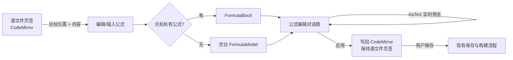

# 数学公式编辑器设计文档

## 1. 设计目的

笔记中的数学公式目前只能直接在源文件里写 `$...$`、`$$...$$`、`:math:` 或 `.. math::`，渲染结果要等到保存并刷新后才能看到。公式写错时，用户需要反复切换渲染页和源文件页；Markdown 的 `$` 与转义规则、reST 的 role/directive 写法也各不相同。表格编辑器已经验证了“在源文件缓冲区打开编辑对话框、应用后回到源文件”的交互方式，数学公式可以复用这条路径。

本设计要解决的是公式的**输入和检查**，不是做一个公式排版系统。第一版提供：从光标处识别已有公式、编辑公式源码、在对话框内用 KaTeX 实时预览、按当前文件格式写回标准 Markdown/reST。后续增强增加了常用结构/希腊字母面板，并扩展了多行环境和 `\(...\)` 的识别。编辑器不引入可视化公式树；也不直接写磁盘，应用后仍由用户保存。

设计基线：`master` 分支，2026-11-27。

## 2. 设计逻辑

关键问题是：**怎样把当前文件里的一段公式源码识别出来，编辑后仍写回同一位置且不破坏上下文？**

公式与表格不同，通常没有固定边框；同一段公式可能是 Markdown 的行内 `$...$`、跨行 `$$...$$`，也可能是 reST 的 `:math:` 或 `.. math::`。因此编辑器不试图理解公式语义，只维护一个带源码范围的 **FormulaBlock**：起点、终点、是否行间公式、原始格式。公式内容作为纯文本交给 KaTeX 预览，写回时重新按格式生成分隔符。



当前识别的公式形态如下：

| 格式 | 行内 | 行间 |
|---|---|---|
| Markdown | `$...$`、`\(...\)` | `$$...$$`、`\[...\]`、`\begin{...}` 环境 |
| reST | ``:math:`...` `` | `.. math::` 及缩进内容 |

识别以当前光标所在行/字符位置为入口，不修改公式以外的文本。没有识别到公式时打开空白公式，应用后插入光标所在位置；这是为了降低首次使用门槛，不要求用户先手写一对分隔符。

对话框中的“结构/大型/希腊字母/矩阵”按钮把常用 TeX 片段插入到当前光标位置，光标自动落在第一个 `{}` 中，仍然可以直接编辑。

公式编辑框中的“行内/行间”决定生成的源码形态。可视化公式树、公式编号、交叉引用不在当前范围。

## 3. 核心数据结构

`FormulaModel` 是编辑器和写回逻辑之间的稳定结构：

```text
FormulaModel
  text: string           # 纯 LaTeX 源码，不含外层分隔符
  display: bool          # false=行内，true=行间
  format: "markdown" | "rst"
```

`FormulaBlock` 是识别结果，只在当前编辑会话内存在：

```text
FormulaBlock
  start: {line, ch}      # 包含分隔符
  end: {line, ch}        # 不包含 end，可直接用于 replaceRange
  model: FormulaModel
```

第一版不解析公式 AST，也不拆解 `\begin{...}` 环境；公式正文作为一段文本原样保留。空公式、未闭合 `$`、未闭合 `$$` 和未闭合 `.. math::` 都视为不可识别，按“没有公式”处理，而不是猜测结束位置。

## 4. 接口定义

### 4.1 源文件入口

源文件工具栏使用统一的「编辑/插入对象」入口；光标在公式中时自动打开公式编辑器，未识别到表格/公式时由新建选择框进入公式编辑器。点击时读取 CodeMirror 的当前内容和光标位置，在浏览器内识别公式；不调用 daemon API。

### 4.2 对话框

对话框包含：

- 公式源码文本框（等宽字体）；
- 行内/行间选择；
- KaTeX 实时预览；
- 「应用到源文件」：写回 CodeMirror，关闭对话框，保持源文件页签，不自动保存；
- 「取消」：不修改源码。

KaTeX 预览失败时显示错误信息，但保留用户输入，不阻止用户继续修改。

### 4.3 源码生成规则

Markdown 行内生成 `$text$`，行间用一对 `$$` 包住内容。reST 行内生成 ``:math:`text` ``，行间生成：

```rst
.. math::

   text
```

写回只替换 `FormulaBlock` 的范围；新建时在光标处插入，行间公式额外补齐首尾换行。

## 5. 一致性与测试

测试覆盖：

- Markdown 行内/行间公式识别和写回；
- reST 行内/`.. math::` 识别和写回；
- 无公式时在光标处插入；
- 公式包含换行、反斜杠和花括号时不被 HTML 转义或丢失；
- 空公式、未闭合分隔符不误判；
- 应用后源文件页签不变，未保存状态保留。

第一版验收标准是：用户在不离开源文件页签的情况下编辑公式，实时看到渲染预览，应用后源码仍能被现有 Markdown/reST 渲染器正确识别。

## 6. 变更历史

| 日期 | 变更原因 |
|---|---|
| 2026-11-27 | 初版：源文件内公式识别、KaTeX 预览、Markdown/reST 写回和第一版边界 |
| 2026-11-27 | 增加结构/大型/希腊字母/矩阵片段面板，并扩展多行环境和 `\(...\)` 识别 |
