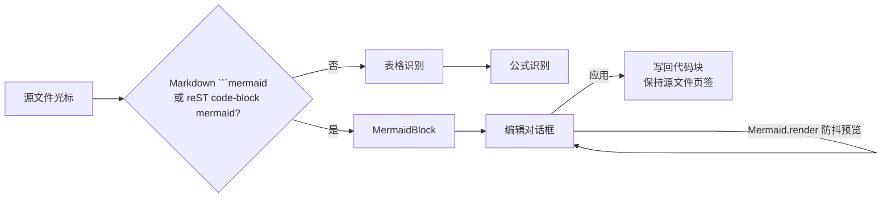

# Mermaid 编辑器设计文档

## 1. 设计目的

Mermaid 图目前只能手写围栏代码块或 reST `code-block`，保存后才知道图是否能解析。Mermaid 的节点文字、箭头和缩进比普通代码更容易出错，但用户通常只需要修改图的一个局部，而不是重画整张图。表格和公式编辑器已经建立了“源文件缓冲区 → 编辑对话框 → 回到源文件”的交互，Mermaid 可以复用同一条路径。

本设计的目标是提供 Mermaid 源码编辑和实时预览，不提供拖拽画图或 Mermaid AST 编辑。第一版支持 Markdown 围栏块和 reST `.. code-block:: mermaid`，支持新建时选择常用模板；应用后关闭对话框、留在源文件页签，不自动保存。

设计基线：`master` 分支，2026-11-27。

## 2. 设计逻辑

关键问题是：**如何在代码块里区分 Mermaid 与普通代码，并在编辑时保持源码位置和格式不漂移？**

Mermaid 在两种格式里都有稳定的容器标记：Markdown 的 info string `mermaid`，reST 的 `.. code-block:: mermaid` 或 `.. code:: mermaid`。因此识别不需要理解 Mermaid 语法，只需找到容器和内容范围。识别优先级放在统一对象入口的最前面，因为 Mermaid 节点文字可能包含 `|` 或 `$`，若先跑表格/公式识别会产生误判。



编辑模型只保存 Mermaid 源码，不解析图类型。预览调用现有的全局 `mermaid.render()`；错误保留源码并显示 Mermaid 错误。新建时提供流程图、时序图、类图、状态图、ER 图、甘特图、饼图和 Git 图模板，模板只是初始文本，不限制后续编辑。

## 3. 核心数据结构

```text
MermaidBlock
  start: {line, ch}       # 包含围栏或 directive
  end: {line, ch}         # 不包含 end
  text: string            # 不含围栏/directive 的 Mermaid 源码
  format: "markdown" | "rst"
```

写回时按 `format` 重新生成容器，不保留旧围栏长度、缩进或代码块选项。

## 4. 接口定义

统一对象入口按以下顺序识别：

1. Mermaid 围栏/代码块；
2. 表格；
3. 公式；
4. 都没有时打开新建选择框。

对话框包含 Mermaid 源码 textarea、防抖实时预览、错误区域和模板选择器。应用时：

- Markdown 生成 info string 为 `mermaid` 的围栏代码块；
- reST 生成 `.. code-block:: mermaid`，内容统一缩进三格。

新建时插入到光标行；已有块时替换整个块。应用后关闭对话框、回到源文件，由用户执行「保存退出」。

Vim 模式提供 `:mermaid` 命令；统一入口仍是 `:object`。

## 5. 边界

第一版不支持：

- 可视化拖拽节点；
- 节点属性面板；
- Mermaid AST 编辑；
- 嵌套在表格单元格里的 Mermaid；
- `.. mermaid::` 自定义 directive；
- 代码块内的 caption、linenos 等 reST 选项。

Mermaid 预览失败只影响预览，不阻止用户把源码写回；保存后的页面由现有 mermaid 运行时给出最终错误。

## 6. 变更历史

| 日期 | 变更原因 |
|---|---|
| 2026-11-27 | 初版：Mermaid 代码块识别、实时预览、模板选择器和统一对象入口 |
