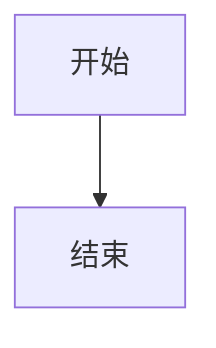

# reST / Markdown 扩展语法与书写约定

本文说明 NoteManager 建议使用的 reST / Markdown 写法，以及相比标准
Docutils / Python-Markdown 额外支持的语法。

目标不是实现完整 Sphinx，而是让常见笔记写法稳定工作。未知的 Sphinx role
通常会被忽略并进入诊断信息，而不是让整篇文档渲染失败。

---

## 1. 文件类型

- `.md`：Markdown；
- `.rst`：reStructuredText；
- `.txt`：纯文本。

`.txt` 只做最简单的段落渲染：空行分段，段内换行变成 `<br>`，不做
dtag、交叉引用、MathJax、Mermaid 或中文自动换行合并。

---

## 2. 文档标签 dtag

标签用于：

- 侧边栏标签；
- 首页主题；
- `dtag:` 搜索。

### reST

```rst
:dtag:`Linux, 内核, 文件系统`
```

- 可以写在正文任意位置；
- 多个标签用逗号分隔；
- 标签本身会从渲染正文中移除，只作为元数据。

### Markdown

```markdown
这是正文。#Linux #内核 #文件系统
```

规则：

- `#` 必须出现在行首、空白或常见中英文标点之后；
- 支持中文、字母、数字、下划线，以及 `/ + _ . -`；
- `# 标题` 是标题，不是标签；
- `[](#anchor)` 中的 `#` 不是标签；
- 建议不要依赖代码块里的 `#tag`。

示例：

```markdown
# 不是标签，这是 Markdown 标题

这是正文 #数学 #概率论
```

---

## 3. 索引词

### reST 索引指令

```rst
.. index:: io_uring
```

### reST 行内索引

```rst
讨论 :index:`io_uring` 的提交队列。
```

- 行内 index 会渲染成正文；
- `.. index::` 和 `:index:` 都会进入搜索索引；
- 搜索使用 `index:关键词`。

Markdown 目前没有等价的 index role；可以用正文关键词或 dtag 表达。

---

## 4. 交叉引用与文档链接

### reST 标签

```rst
.. _my-label:

目标章节
--------

参见 :ref:`my-label`，或 :ref:`目标章节 <my-label>`。
```

- 标签定义写在目标文档中；
- `:ref:` 会解析到标签所在文档；
- 标签也会进入 `label:` 搜索。

### reST 文档链接

```rst
参见 :doc:`../Linux内核/io_uring`。
```

- `:doc:` 的目标是源文件路径，不带 `.html`；
- 构建时转换成相对 HTML 链接；
- 目标不存在时不会自动创建文档。

### Markdown 链接

```markdown
参见 [io_uring](../Linux内核/io_uring.md)。
```

构建时会把本地 `.md` / `.rst` / `.txt` 链接转换成 `.html`。

Markdown 也有标准的标题锚点（例如 `#section`），但没有与 reST
`:ref:` 标签等价的跨文档标签定义。

### 建议

- 跨文档引用优先使用相对路径；
- 不要写死 `.NoteManager/html/...`；
- 不要在链接里写站点绝对路径。

---

## 5. 中文软换行合并

这是 NoteManager 相对普通 Markdown/reST 渲染最重要的排版差异。

### 规则

在**同一个段落内部**，单个换行会被合并：

| 源码换行两侧 | 渲染结果 |
|---|---|
| 中文 / 中文 | 直接拼接，不留空格 |
| 中文 / English | 直接拼接，不留空格 |
| English / 中文 | 直接拼接，不留空格 |
| English / English | 保留一个空格 |

因此中文可以按任意列宽折行：

```markdown
这是一段很长的中文，为了方便编辑，
我把它拆成了几行，
渲染时会自动接成一段。
```

渲染为：

```text
这是一段很长的中文，为了方便编辑，我把它拆成了几行，渲染时会自动接成一段。
```

### 段落边界

- Markdown/reST 中，空行才表示新段落；
- 段落内部的换行会被合并；
- 代码块、`<pre>`、`<code>`、表格单元格不参与这个合并；
- 需要强制换行时，使用 Markdown 行尾两个空格 + 换行，或 `<br>`；
- reST 可以使用 line block（行块）或原始 HTML `<br>`。

### 中西文之间需要空格时

因为换行本身不产生空格，如果需要：

```text
NoteManager 
是一个工具
```

请在前一行末尾显式留下一个空格，或直接写成同一行。

---

## 6. 数学公式

Markdown/reST 的数学公式由浏览器端 KaTeX 渲染。

### Markdown

支持：

```markdown
行内公式 $E=mc^2$。

$$
\int_0^1 x^2 dx
$$
```

也支持：

- `\( ... \)`
- `\[ ... \]`
- `\begin{align} ... \end{align}`

代码围栏中的 `$...$` 不会被当作公式保护/替换。

### reST

```rst
行内公式 :math:`E=mc^2`。

.. math::

   \int_0^1 x^2 dx
```

复杂公式建议用 `.. math::` 或 Markdown 的 `$$...$$`。

---

## 7. Mermaid 图表

### Markdown

```markdown

```

### reST

```rst
.. code-block:: mermaid

   graph TD
       A[开始] --> B[结束]
```

前端会查找 `pre.mermaid` 并用 Mermaid.js 渲染。建议显式写 `mermaid`
语言标记。

支持常见的 `graph` / `flowchart` / `sequenceDiagram` / `classDiagram` /
`stateDiagram` / `gantt` / `journey` / `gitGraph` 等 Mermaid 图表类型。

---

## 8. 代码块与 ASCII 图

### Markdown

````markdown
```python
print("hello")
```
````

### reST

```rst
.. code-block:: python

   print("hello")
```

支持 Pygments 代码高亮。

另外，包含足够多框线字符（如 `┌ ┐ └ ┘ │ ─ ├ ┤`）的代码块/字面块会被
自动标记为图示样式（`nm-diagram`），不需要额外语法。

---

## 9. reST 扩展指令

NoteManager 注册了以下简化指令：

### `.. toctree::`

```rst
.. toctree::
   :maxdepth: 2
   :caption: 目录

   foo
   bar
```

注意：这是**简化列表**，不是完整 Sphinx toctree：

- 不会自动展开子目录；
- 不会生成 Sphinx 的隐式文档树；
- 条目会生成指向文档的链接；
- 不要依赖 Sphinx 的 `glob` / `hidden` 等完整行为。

普通文档链接仍然是更可靠的方式。

### `.. cnote::`

```rst
.. cnote:: 注意

   这里是提示内容。
```

渲染为带标题的提示块。

### `.. centered::`

```rst
.. centered::

   居中显示的内容。
```

---

## 10. reST 标准能力

以下标准 Docutils 能力通常可用：

- `.. image::` / `.. figure::`
- `.. note::` / `.. warning::` / `.. tip::`
- `.. code-block::`
- `.. math::`
- 简单表格、列表、引用、脚注
- 文档信息字段：
  - `:Author:`
  - `:Version:`
  - `:Date:`
  - `:Status:`

文档信息会从正文中提取并显示在诊断信息里。

### 不支持或不应依赖

- `.. include::` 被关闭，不能插入其他源文件；
- 完整 Sphinx 主题、扩展、`conf.py`；
- Sphinx 专有 role（如 `:term:`、`:guilabel:` 等）；
  - 未注册的 role 会被忽略，并在诊断里提示；
- Sphinx 的完整 `toctree`、自动摘要、索引生成等行为。

---

## 11. Markdown 启用的标准扩展

当前启用：

- `fenced_code`
- `codehilite`
- `tables`
- `toc`
- `md_in_html`

因此支持：

- 围栏代码块；
- 代码高亮；
- 表格；
- 标题自动生成 TOC；
- Markdown 中嵌入简单 HTML。

不启用 YAML front matter、脚注、任务列表等额外扩展。**不要使用 YAML
frontmatter 代替 dtag**；请使用正文中的 `#tag` 或 reST 的 `:dtag:`。

---

## 12. 图片与 `_static/`

推荐：

```markdown

```

```rst
.. image:: _static/image.png
   :alt: 说明
```

约定：

- 图片放在文档所在目录的 `_static/`；
- 使用相对路径；
- 构建时会复制到 HTML 输出树；
- 图片引用会进入 `_index/assets.json`；
- 未引用图片可以在「资源」里清理；
- 删除笔记时，只被本文引用的图片可以选择一起移动到回收站。

---

## 13. 推荐写法

### Markdown

```markdown
# 标题

这是正文 #标签。

参见 [另一篇](../other.md)。


$$
E=mc^2
$$
```

### reST

```rst
标题
====

:dtag:`标签`

这是正文。

参见 :ref:`other-label`。

.. image:: _static/example.png

.. math::

   E=mc^2
```

---

## 14. 和搜索索引的关系

构建时会从正文和源码中提取：

| 类型 | 来源 |
|---|---|
| `chapter` | 章节标题 |
| `dtag` | reST `:dtag:` / Markdown `#tag` |
| `index` | reST `.. index::` / `:index:` |
| `label` | reST `.. _label:` |
| `fname` | 文件名 |
| `grep` | 正文块 |

因此写标签、索引和稳定标题，会直接改善：

- `dtag:` / `index:` / `label:` 搜索；
- 首页主题；
- 文档关系；
- 命令面板快速打开。

---

## 15. 简短结论

- 中文可以自由折行，段落内单换行会自动接起来；
- 空行才分段；
- 代码、公式、表格内不要依赖自动换行；
- 标签：reST 用 `:dtag:`，Markdown 用 `#tag`；
- 交叉引用：reST 用 label/ref/doc，Markdown 用相对链接；
- 图片统一放目录级 `_static/`；
- 不追求完整 Sphinx 兼容，未知 role 会被忽略并提示。

更完整的搜索语法见 [搜索策略说明](搜索策略说明.md)。
