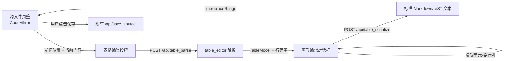

# 表格图形编辑器设计文档

## 1. 设计目的

Markdown 与 reST 的表格在源码里都由多行文本组成。改一个单元格往往要重新对齐竖线和分隔行，尤其是 reST 的 grid table；直接在 CodeMirror 里编辑，格式错误不会立即显现，用户需要反复保存、查看渲染结果。图片标注已经证明“选中对象 → 图形界面编辑 → 回到源文件”这条路径适合本工具，因此表格也需要一个类似的编辑入口。

本设计的目标不是做通用电子表格，也不是做富文本编辑器，而是让用户在不离开笔记编辑流程的前提下完成常见表格操作：改单元格文字、增删行列、设置表头和列对齐，然后把结果写回当前源文件缓冲区。表格内容仍以源码中的原始行内标记为准，不把 `**粗体**`、`:ref:` 等语法转成不可逆的富文本。

第一版只支持从「源文件」页签的当前光标位置识别表格；渲染区表格点击编辑留到后续版本，因为它需要渲染器为每个 `<table>` 注入源码范围。第一版也不新增写盘接口：编辑结果替换 CodeMirror 内容；「应用到源文件」关闭表格对话框、留在源文件页签，用户继续编辑文本后用现有的「保存并刷新渲染」落盘，保留未保存提示和撤销能力。

设计基线：`master` 分支，2026-11-27。

## 2. 设计逻辑

本设计要回答的核心问题是：**怎样在不重新发明 Markdown/reST 解析器的前提下，把一段表格源码安全地变成可编辑模型，再变回标准源码？**

表格编辑只涉及三件事：找到表格在源码中的行范围、把范围解析成二维单元格、把单元格序列化回可被原渲染器接受的语法。三件事都不需要 daemon 维护状态，也不应该写文件。因此模型的生命周期限制在一次编辑会话内，源码行范围由前端 CodeMirror 提供，解析和序列化作为无副作用的请求完成。



解析器按文件扩展名选择格式适配器：`.md` 使用 Markdown 管道表格，`.rst` 使用 reST grid table 或 simple table。模型统一为“表头 + 数据行 + 列对齐”，序列化时统一输出该格式的标准写法；第一版 reST 的 simple table 被规范化为 grid table，避免在编辑后还要重新计算 simple table 的列宽和跨行边界。

为避免把“编辑表格”做成新的保存通道，接口只接收当前缓冲区内容和光标行号，不读取、不写入项目文件。这样即使用户在编辑器里还有未保存内容，也能以缓冲区为准；取消编辑不会改变文件。

概念空间：

* **TableBlock**：源码中一段可独立替换的表格，包含起止行号和格式。
* **TableModel**：图形编辑器使用的二维结构，包含表头、数据行、列对齐和原格式。
* **格式适配器**：把 TableBlock 与 TableModel 互相转换的纯函数；Markdown 与 reST 各有实现。
* **单元格原文**：单元格里未经解释的 Markdown/reST 行内文本；编辑器只编辑这段文本，不解释成富文本。

## 3. 核心数据结构

`TableModel` 是编辑器和序列化器之间的唯一定义。它不记录字体、颜色或 DOM 身份，只记录表格语义：

```text
TableModel
  format: "markdown" | "rst-grid"
  header: bool
  align: ["left" | "center" | "right" | "default", ...]
  rows: [
    ["表头 A", "表头 B"],
    ["正文 1", "正文 2"],
    ...
  ]
```

`TableBlock` 只在前端和解析 API 的返回值中出现：

```text
TableBlock
  start_line: int      # 0-based，包含
  end_line: int        # 0-based，包含
  model: TableModel
```

`align` 的长度必须等于列数；`rows` 至少有一行。`header=true` 时第一行是表头；Markdown 管道表格必须保留表头，reST grid table 用分隔线表达表头。

第一版不支持合并单元格、嵌套表格、带 caption 的 `.. table::`、`list-table` 和单元格内多段正文。遇到这些结构时解析器返回明确错误，而不是生成可能破坏原文的近似结果。

## 4. 接口定义

### 4.1 解析接口

```http
POST /api/table_parse
Content-Type: application/json

{"content": "<当前编辑器全文>", "line": 42, "ext": ".rst"}
```

返回：

```json
{
  "ok": true,
  "table": {
    "start_line": 30,
    "end_line": 36,
    "format": "rst-grid",
    "header": true,
    "align": ["default", "default"],
    "rows": [["A", "B"], ["1", "2"]]
  }
}
```

`line` 是 0-based 光标行；`content` 是 CodeMirror 当前缓冲区，不是磁盘文件。找不到表格、表格结构不支持或内容不完整时返回 `ok:false` 和可读的 `error`。

### 4.2 序列化接口

```http
POST /api/table_serialize
Content-Type: application/json

{"format": "markdown", "header": true, "align": ["left", "right"],
 "rows": [["A", "B"], ["1", "2"]]}
```

返回：

```json
{"ok": true, "text": "| A | B |\n| :--- | ---: |\n| 1 | 2 |\n"}
```

序列化器只生成标准源码，不写文件。前端拿到 `text` 后用 CodeMirror 的 `replaceRange` 替换 `start_line` 到 `end_line` 的范围。

### 4.3 前端入口

源文件工具栏增加「编辑/插入表格」按钮。点击时：

1. 读取 `cm.getValue()` 和 `cm.getCursor().line`；
2. 调用 `/api/table_parse`；
3. 光标不在表格内时，打开一个两行两列的空白表，应用到源文件时插入到当前行；
4. 打开模态编辑器；每一行和每一列都有独立的删除按钮，不要求从末尾删除；
5. 用户点「应用到源文件」后调用 `/api/table_serialize`；
6. `cm.replaceRange()` 替换或插入表格，保留撤销栈，并把光标放回表格起点；
7. 「应用到源文件」关闭表格对话框并回到源文件页签，不切换渲染、不自动保存；用户继续编辑文本后，再点击「保存并刷新渲染」。

第一版不监听渲染区表格点击。渲染器目前没有给表格提供稳定的源码行号，若直接按 DOM 反推源码会引入不可控的歧义。

## 5. 格式与失败边界

Markdown 只接受标准管道表格，且必须有分隔行；分隔行中的 `:---`、`:---:`、`---:` 映射为列对齐。单元格中的 `|` 暂时要求用户自行转义；第一版不自动猜测转义。

reST grid table 的 `+---+` 边框和 `+===+` 表头分隔线是结构依据；第一版要求每行是单行单元格，不支持跨行。reST simple table 的 `===  ===` 边框用于识别，编辑后统一写成 grid table，确保任意单元格宽度变化后仍然合法。

## 6. 一致性与测试

解析器和序列化器是纯函数，测试覆盖：

* Markdown 管道表格的解析、表头/对齐和回写；
* reST grid table 的解析、表头/对齐和回写；
* reST simple table 的识别和规范化；
* 光标不在表格内、合并结构、缺少分隔行等失败路径；
* 前端替换范围只覆盖目标表格，不改变前后文本。

第一版的验收标准是：用户能在源文件页签把光标放进表格，通过图形界面改单元格和增删行列，应用后源文件仍是合法的 Markdown/reST，保存并刷新后表格渲染正确。

## 7. 变更历史

| 日期 | 变更原因和内容 |
|---|---|
| 2026-11-27 | 初版：光标定位、表格模型、解析/序列化接口和第一版格式边界 |
| 2026-11-27 | 增加空白表格插入、任意行列删除，并兼容无表头 reST grid table 和无分隔行 Markdown 管道表格的迁移编辑 |
