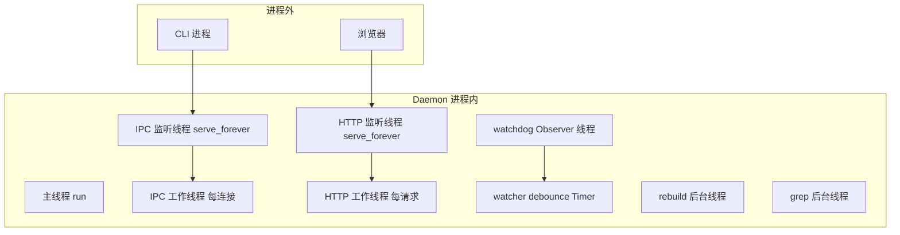

# 代码结构

## 介绍

本文介绍NoteManager的代码结构。整个软件实现在notemanager目录中，其中：

* cli.py实现基本的nmr命令，每个子命令xxx对应一个xxx_cmd()函数

* daemon.py实现后台进程，实现为一个类NoteManagerDaemon。调用run()后，会创建后台服务，自身会进入等待（\_shutdown.wait()）。后台服务有三个：

  * 和cli的通讯实现在TCPHandle.handle()中，做recv_command(), daemon_ref.handle_command(cmd), send_response(self.request, resp)三个动作

  * http监听，被start_web_server()启动，用WebHandler处理每个请求。这个具体实现在web.py中。对于GET和POST进行不同的处理。

  * 后台文件监控，这个用start_watcher启动，实现在watcher.py中，它使用了一个watchdog.Observer服务监听NoteWatchHandler对象，

此外，还有如下模块：

* protocol.py 封装CLI到daemon的IPC协议，用cli send_command或者TCPHandler recv/send/recv_response()
* scanner.py 提供扫描目录的功能：scan_directory(project_root) -> list[FileInfo]
* scan_manifest.py 维护工程/.NoteManager/scan_manifest.json，用于冷启动时判断是否需要full_build（与 daemon._need_rebuild_on_startup 配合）。
* builder.py 全量/增量生成 工程/.NoteManager/html/、索引、状态等；编排扫描、渲染、引用解析、索引写入。full_build(project_root, ...), update_file(project_root, file_path, ...), remove_file(project_root, file_path)
* relations.py 构建时解析文档内部链接、标签、章节/索引词，生成 _index/relations.json，供文档页「文档关系」面板使用。
* activity.py 构建时生成 _index/activity.json（文档 mtime/标题），供首页「我的阅读 / 自上次访问」使用。
* assets.py 构建时扫描图片引用，生成 _index/assets.json，供删除时的独占图片判断使用。
* renderer/assets/nm-command.js 提供 Ctrl/⌘+K 命令面板、文档快速搜索和 localStorage 快捷视图。
* renderer/assets/nm-filetree.js 提供目录树新建笔记、删除确认和回收站操作。
* overview.py 构建时生成项目概览：生成带篇数/章节数/近期活跃度的径向目录关系图和标签/索引词/章节/文档主题；写出 _index/overview.json、topics.html 和主页概览 HTML；不依赖 LLM。
* ref_resolver.py 从全工程扫描 reStructuredText 标签（ref 等），并在 HTML 上做 `:ref:` / 文档链接 等解析与改写。extract_labels(project_root, files) -> dict；resolve_references(html, current_html_path, ref_labels, ...)（具体签名以源码为准）。
* indexer.py 搜索/浏览索引：从各页 HTML 抽取章节、dtag、index 术语等，生成 search_index.json 等；查询解析与过滤；从源码抽 dtags、RST index 指令等。对外接口（常被 builder / daemon 搜索逻辑使用）：build_index(...)；parse_search_query；filter_search_documents；extract_dtags_from_sources；extract_rst_index_directives；extract_md_hashtags 等。
* index_body.py 从整页控制台 HTML 里取出 侧栏/面板用的内层 HTML 片段（供索引条目等与面板展示一致）。extract_render_panel_inner_html(full_page_html) -> str。
* server.py 独立静态 HTTP 服务（例如调试）：只读提供 工程/.NoteManager/html，不经过 daemon。对外接口：serve(directory, port=8000)（阻塞运行）。
* renderer/md_renderer.py Markdown → HTML（含链接、mermaid 代码块等处理）。实现render_md(content, source_path) -> dict
* renderer/rst_renderer.py rst版本的renderer
* renderer/template.py 控制台用 整页 HTML 模板（侧栏、CodeMirror、搜索壳、wrap_html 等）。对外接口：wrap_html(...)（builder / daemon 临时预览等使用）。
* renderer/postproc.py 对 docutils 产出的 HTML 做 标题层级修正、章节编号、目录编号、由标题生成 TOC 等后处理。fix_docutils_html5_heading_levels；add_section_numbers；add_toc_numbers；generate_toc_from_headings。
* renderer/directives.py/roles.py 向 docutils 注册工程自定义 指令（directive）与角色（role）（toctree、cnote、:ref:、:doc:、dtag、index、math 等）

## 线程模型

Daemon 进程内与 `.NoteManager`（各工程根下）磁盘读写相关的活动，来自多条线程：`Threading*Server` 为**每个连接/请求**派生的工作线程、文件监控与定时器、以及可选的后台任务线程。CLI 与浏览器只作为**进程外客户端**，通过 Unix 套接字/TCP 或 HTTP 与上述线程交互。

说明：

- **主线程**：`NoteManagerDaemon.run()` 中启动 IPC/HTTP 与监控恢复后，在 `self._shutdown.wait()` 上阻塞；不直接 `accept`，也不处理 HTTP 请求。
- **IPC 监听线程**：`threading.Thread(target=self._tcp_server.serve_forever)`，底层为 `ThreadingUnixStreamServer` 或 `ThreadingTCPServer`（`notemanager/daemon.py`）。
- **IPC 工作线程**：由 `Threading*Server` 为每个 CLI 连接创建；在 `TCPHandler.handle` 中 `recv_command` → `handle_command` → `send_response`。
- **HTTP 监听线程**：`start_web_server` 内 `Thread(target=server.serve_forever)`（`notemanager/web.py`）。
- **HTTP 工作线程**：`ThreadingHTTPServer` 为每个请求创建；`WebHandler` 调用 `daemon_ref` 上各类 API 对应方法。
- **watchdog Observer 线程**：`Observer.start()` 后为每个被监控工程提供的底层读事件循环（`watchdog` 库）。
- **debounce Timer 线程**：`NoteEventHandler._schedule_update` 中 `threading.Timer`；到期后在 Timer 线程里调用 `builder.update_file` / `remove_file`。
- **rebuild 后台线程**：仅 **CLI 异步重建**（`handle_rebuild`）通过 `_rebuild_worker` 起线程跑 `full_build`；**Web 面板 `/api/rebuild`** 调用 `rebuild_directory`，在**当前 HTTP 工作线程**内同步执行 `full_build`，不经过该后台线程。
- **grep 后台线程**：`start_grep_search` 等为搜索起的 worker 线程；主要读源码与索引，默认不向工程内 `.NoteManager` 写入构建产物（若实现变更需同步更新本文）。

### 可能访问工程目录与 `.NoteManager` 的线程与代码路径

下表中的「线程」指**实际执行该调用的线程类型**（同一类型可有多个并发实例，例如多个 HTTP 工作线程）。

| 线程类型 | 典型触发 | 对 `.NoteManager` 或构建树的主要操作 |
|----------|----------|--------------------------------------|
| IPC 工作线程 | `nmr rebuild`（异步 job）、`nmr search` 等 | 异步 rebuild：`full_build` 写 HTML、`_index`、`status.json`、`scan_manifest.json` 等；search 多为主读 `html/_index/search_index.json` |
| HTTP 工作线程 | `/api/rebuild`、`/api/save_source`、`/api/create_note`、`/api/delete_note`、`/api/add`（含首次 `full_build`）等 | `rebuild_directory` → `full_build`；`save_managed_source` / `create_note_same_dir` / `delete_managed_source` → 写源文件后 `update_file` / `remove_file`；`add_directory` 中 `full_build` + 注册 watcher |
| 主线程 | `run()` 启动阶段恢复配置中的目录 | 对每个目录可能 `full_build`，再 `start_watcher`；与后续并发请求叠加时无单独磁盘锁 |
| debounce Timer 线程 | 用户或外部工具修改/删除 `.md`/`.rst` | `update_file` / `remove_file`，重写单页 HTML 与全量索引相关 JSON |
| rebuild 后台线程 | CLI `handle_rebuild` | 与上表「IPC 工作线程发起」相同，但 `full_build` 在独立线程中跑 |
| 其他 | `remove_directory`（HTTP 或未来 CLI） | 停止 watcher 后 `shutil.rmtree(工程/.NoteManager)` |

**进程外补充**：`nmr export` 等在 **CLI 进程**内调用 `export_mobile_html_zip`，默认向**临时目录**渲染并打 zip，一般不写回工程下的 `.NoteManager/html`；与 Daemon 内构建并发时，仅当二者同时读同一源文件时存在普通读并发，不涉及 Daemon 对同一 `.NoteManager` 目录的锁协议。

### 并发与同步（实际保证与未保证）

**内存与配置**

- `daemon._lock`：`with self._lock` 保护 `_observers` 字典及配置列表的**一致性读取/更新**（如复制 `directories` 列表、注册/注销 `Observer`）。持锁时间刻意缩短，**不包含** `full_build` / `update_file` 整段执行。
- `_rebuild_job_lock`：仅串行化 **CLI 异步重建 job** 的创建与「同时仅一个 active job」语义；**不**覆盖 Web `/api/rebuild` 的同步 `full_build`。
- `NoteEventHandler._lock`：同一工程 handler 内对 `_pending` 与 debounce `Timer` 的互斥，**不**与其它线程上的 `full_build` 互斥。
- `suppress_path`（模块级 `_SUPPRESS_LOCK`）：在短时间窗内让 watcher **跳过**指定路径的事件，减轻「Daemon/Web 写源文件 → 立刻又触发增量构建」的重复；**不是**全工程构建互斥锁。

**磁盘 `.NoteManager`**

- `builder.full_build`、`update_file`、`remove_file` **未**使用文件锁（如 `flock`）或「每工程单写者」队列。
- 因此：**Web 请求、CLI 命令、watcher 增量、启动时主线程 full_build** 可能在**同一工程**上交错执行两段构建逻辑，存在索引/HTML 后写覆盖先写、或读者看到中间态的可能；依赖场景上「少并发全量重建」与 debounce、suppress 降低冲突概率，而非严格可证无冲突。

若需严格串行化对某一工程 `工程/.NoteManager` 的写入，需在架构上增加**每工程构建锁**或**单写线程任务队列**，使 `full_build` 与 `update_file`/`remove_file` 同一时刻至多执行一个。

## html网页结构

[html网页结构](html网页结构.md)
